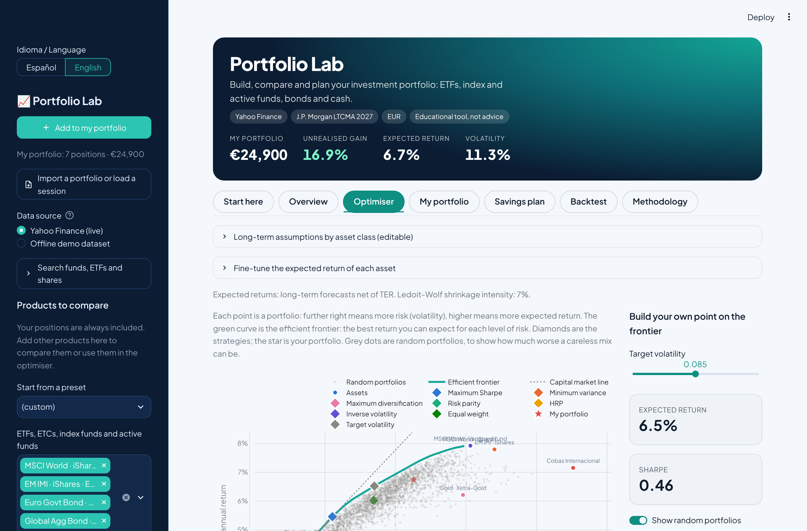
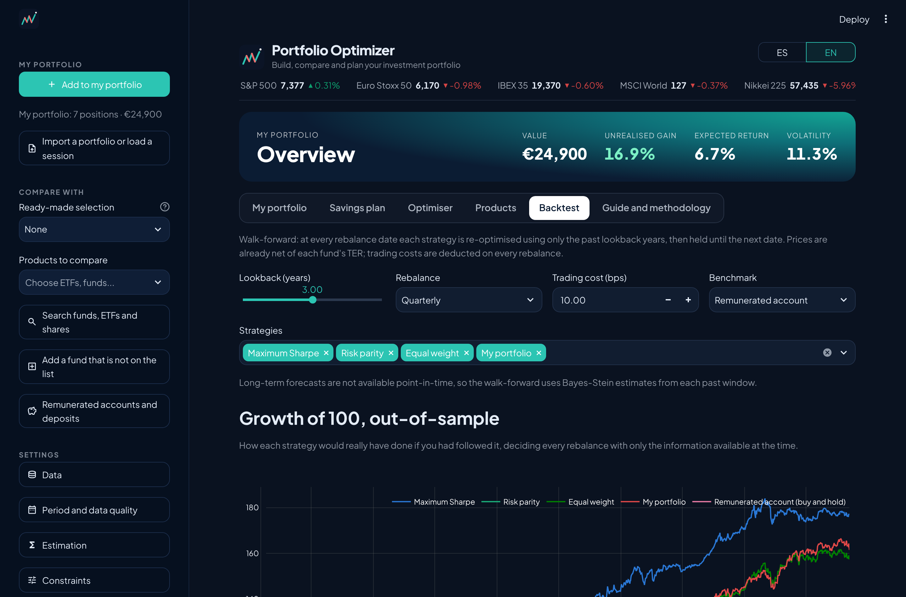
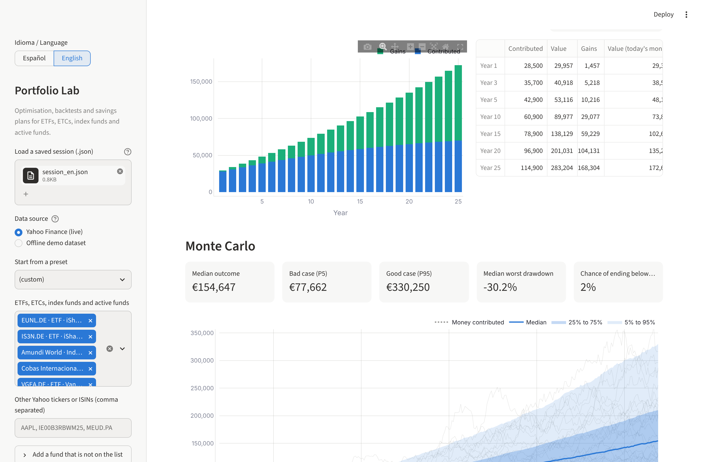

# Portfolio Lab: optimisation, backtesting and Monte Carlo for ETFs, ETCs and index funds

[](https://github.com/rodrisantana/portfolio-optimizer/actions/workflows/ci.yml)

An interactive tool to design and stress-test a long-only investment portfolio from the point of view of a
euro-based retail investor. It started as a plain Markowitz optimiser and now covers the whole workflow:

* **Real instruments.** UCITS ETFs, physical ETCs (gold, silver), crypto ETNs and **index funds resolved from
  their ISIN** (Vanguard, Fidelity, Amundi, iShares), plus any Yahoo ticker or your own NAV history as a CSV.
* **Multi-currency.** Every price is converted to your base currency with daily FX, and LSE quotes in pence (GBp)
  are fixed automatically, so the results include the currency risk you actually bear.
* **Robust estimation.** Bayes-Stein shrinkage of expected returns, Ledoit-Wolf shrinkage of the covariance, weekly
  returns to avoid the non-synchronous-close bias between exchanges.
* **Seven allocation methods.** Maximum Sharpe, minimum variance, maximum diversification, risk parity, hierarchical
  risk parity (HRP), inverse volatility and equal weight, with per-asset caps and asset-class limits.
* **Honest testing.** Walk-forward backtests that only use past data at each rebalance, with trading costs and TERs.
* **Planning.** Monte Carlo projection (log-normal, fat-tailed Student-t or historical block bootstrap) with monthly
  contributions or withdrawals, inflation and fees, plus the monthly saving needed to reach a goal.
* **Your own portfolio.** Compare it with the efficient frontier, see where its risk comes from and get a rebalancing
  plan that uses new cash first, with an estimate of the Spanish tax (IRPF) on any sale and tax-free *traspasos*
  between index funds.



## Quick start

```bash
git clone https://github.com/rodrisantana/portfolio-optimizer.git
cd portfolio-optimizer
pip install -r requirements.txt

streamlit run app.py          # interactive app
python main.py                # command-line run + HTML report in outputs/
python main.py --demo         # same, fully offline with the bundled dataset
```

In the app, load `examples/sample_session.json` from the sidebar to see every tab filled in with a sample portfolio.
Your own universe, settings and holdings can be saved the same way.

## What is inside

| Tab | What it answers |
|---|---|
| **Overview** | Performance, drawdowns, correlations and calendar-year returns of each asset, all in your base currency. TERs are editable. |
| **Optimiser** | Efficient frontier with the capital market line, every strategy side by side, weights, and capital weight vs. risk contribution. You can override expected returns with your own assumptions. |
| **My portfolio** | Where your current portfolio sits, how much return you leave on the table at the same risk, and the trades to reach a target (cash-only or full rebalance, with tax estimate). |
| **Backtest** | Out-of-sample walk-forward comparison against a buy-and-hold benchmark: CAGR, Sharpe, Sortino, max drawdown, CVaR, beta, tracking error, turnover. |
| **Monte Carlo** | Fan chart of future wealth in today's money, probability of reaching a goal or running out of money, and the contribution required. |

<p>
  
  
</p>

## Methods

For weights $w$, expected returns $\mu$ and covariance matrix $\Sigma$ (annualised):

$$\mu_p = w^\top \mu, \qquad \sigma_p^2 = w^\top \Sigma w, \qquad S = \frac{\mu_p - r_f}{\sigma_p}$$

**Expected returns.** The sample mean is the noisiest input in portfolio theory: with eight years of data its standard
error for an equity ETF is about 6% a year. The default is the Bayes-Stein estimator (Jorion, 1986), which pulls each
mean towards the return of the minimum-variance portfolio:

$$\hat\mu_{BS} = (1-\phi)\,\hat\mu + \phi\,\mu_0\mathbf{1}, \qquad
\phi = \frac{N+2}{(N+2) + T(\hat\mu-\mu_0\mathbf{1})^\top S^{-1}(\hat\mu-\mu_0\mathbf{1})}$$

**Covariance.** Ledoit-Wolf (2004) shrinkage towards the constant-correlation matrix, $\hat\Sigma = \delta F + (1-\delta)S$,
with the optimal intensity $\delta$ estimated from the data. The target keeps each asset's own variance, so a bond ETF
stays a low-volatility asset.

**Maximum Sharpe and maximum diversification.** Maximising a ratio is not a convex problem, but it is homogeneous of
degree zero. With $y = \kappa w$ it becomes the convex quadratic programme

$$\min_y\; y^\top \Sigma y \quad \text{s.t.}\quad (\mu - r_f\mathbf{1})^\top y = 1,\quad \ell\,\kappa \le y \le u\,\kappa,
\quad \kappa = \mathbf{1}^\top y$$

so the global optimum is guaranteed even with weight caps and asset-class limits. Maximum diversification uses the
vector of volatilities instead of excess returns.

**Risk parity.** Solved through the convex programme of Spinu (2013),
$\min_y \tfrac12 y^\top\Sigma y - \sum_i b_i \ln y_i$, whose solution equalises the risk contributions
$RC_i = w_i(\Sigma w)_i / \sigma_p^2$.

**HRP.** Hierarchical clustering on the distance $d_{ij}=\sqrt{(1-\rho_{ij})/2}$, quasi-diagonalisation and recursive
bisection (Lopez de Prado, 2016). It never inverts $\Sigma$, which makes it stable with near-duplicate assets.

**Monte Carlo.** Monthly steps $V_{t+1} = \max\!\big(0,\; V_t(1 + r_t - f/12) + C_t\big)$. The log-normal parameters are
moment-matched so the simulated mean and volatility equal the inputs exactly:
$s^2 = \ln\!\big(1 + \sigma^2/(1+\mu)^2\big)$, $m = \ln(1+\mu) - s^2/2$.

All optimisation problems are solved with SciPy (SLSQP with analytic gradients, HiGHS for the linear feasibility
checks). The test suite checks the results against closed-form solutions and brute-force searches.

## Project structure

```
portfolio_optimizer/
├── catalog.py      curated ETFs, ETCs and index funds (tickers verified on Yahoo, ISIN, TER, proxy)
├── data.py         download, ISIN resolution, FX conversion, bad-tick filter, alignment, caching
├── estimators.py   historical / EWMA / Bayes-Stein means; sample / Ledoit-Wolf / EWMA covariance
├── optimizer.py    mean-variance, risk parity, HRP, frontier, constraints, risk contributions
├── metrics.py      CAGR, Sharpe, Sortino, drawdowns, VaR / CVaR, beta, tracking error
├── backtest.py     drifting-weight simulation, rebalancing, costs, walk-forward optimisation
├── montecarlo.py   projections with contributions, inflation and fees; required contribution
├── holdings.py     current portfolio, rebalancing plan, Spanish savings-income tax
├── charts.py       Plotly figures shared by the app and the report
└── report.py       end-to-end run from config.toml and HTML report
app.py              Streamlit application
main.py             command-line entry point
config.toml         configuration for the command-line run
data/demo_prices.csv  offline dataset (8 UCITS products in EUR, 2018-2026)
docs/guide.html     illustrated guide to how the project works (Spanish)
tests/              pytest suite, runs offline
```

## Configuration (command line)

Edit `config.toml`: assets (tickers or ISINs), base currency, estimators, constraints, backtest and Monte Carlo
settings. Running `python main.py` prints a summary and writes `outputs/report.html` (interactive charts) and
`outputs/results.md`.

## Deploying the app

The app runs on [Streamlit Community Cloud](https://streamlit.io/cloud) for free: point it at this repository and
`app.py`. The requirements file is already in place.

## Limitations

* Expected returns cannot be estimated precisely from a few years of data. The app shows the standard error of
  each estimate and lets you type your own assumptions; use them.
* Yahoo Finance is free but not perfect: some European listings have gaps or bad prints (a filter removes one-day
  spikes) and fund histories only start in 2018. Prefer accumulating share classes, whose prices already include
  dividends.
* The tax estimate uses average cost and ignores loss offsetting. This project is a learning and analysis tool, not
  financial or tax advice.

## References

* Markowitz, H. (1952). Portfolio Selection. *The Journal of Finance*, 7(1), 77-91.
* Jorion, P. (1986). Bayes-Stein Estimation for Portfolio Analysis. *Journal of Financial and Quantitative Analysis*, 21(3), 279-292.
* Ledoit, O. and Wolf, M. (2004). Honey, I Shrunk the Sample Covariance Matrix. *Journal of Portfolio Management*, 30(4), 110-119.
* Cornuejols, G. and Tutuncu, R. (2007). *Optimization Methods in Finance*. Cambridge University Press.
* Choueifaty, Y. and Coignard, Y. (2008). Toward Maximum Diversification. *Journal of Portfolio Management*, 35(1), 40-51.
* Spinu, F. (2013). An Algorithm for Computing Risk Parity Weights. SSRN 2297383.
* Lopez de Prado, M. (2016). Building Diversified Portfolios that Outperform Out of Sample. *Journal of Portfolio Management*, 42(4), 59-69.
