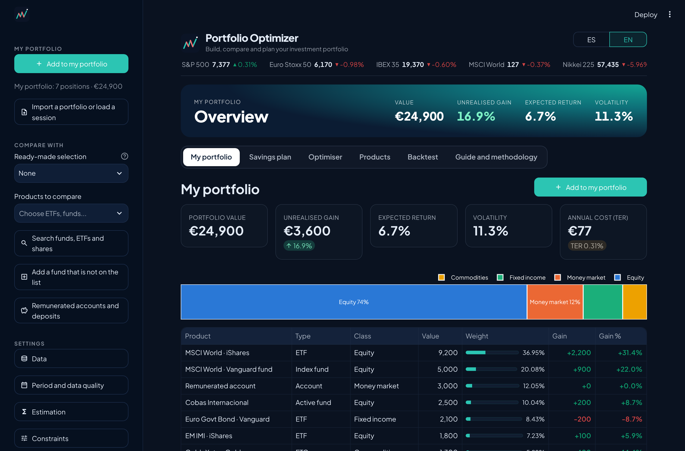
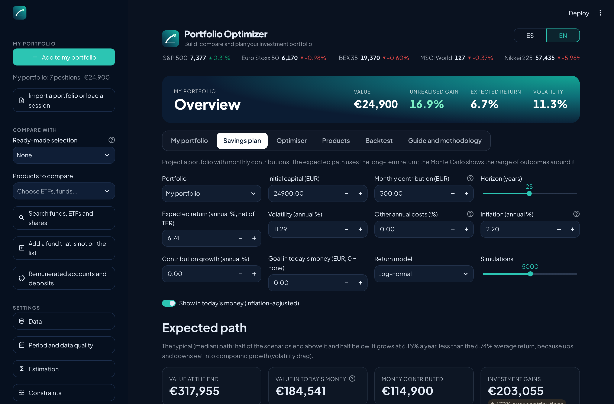

# Portfolio Optimizer: optimisation, backtesting and Monte Carlo for ETFs, ETCs and index funds

[](https://github.com/rodrisantana/portfolio-optimizer/actions/workflows/ci.yml)

An interactive tool, in **English and Spanish**, to design, test and plan a long-term investment portfolio from
the point of view of a euro-based retail investor. It started as a plain Markowitz optimiser and now covers the
whole workflow:

* **Every kind of product.** UCITS ETFs, physical ETCs (gold, silver), crypto ETNs, **passive index funds** (Vanguard,
  Fidelity, iShares, the Amundi index range) and **actively managed funds** (Cobas, Azvalor, Magallanes,
  Bestinver, True Value, Fundsmith, Carmignac, DWS, Comgest...), all found by ISIN. Funds Yahoo does not cover are
  simulated from an ETF (or blend of ETFs) on the same index minus the fee difference, and you can add your own.
* **Expert long-term forecasts.** Expected returns come from J.P. Morgan's *2027 Long-Term Capital Market
  Assumptions* (euro table, 10-15 years) per asset class and region, net of each fund's TER, with an optional alpha
  for active managers (zero by default, as the SPIVA evidence suggests). Editable, with a more conservative set and
  historical / Bayes-Stein estimates for comparison.
* **Cash and bonds too.** Money-market funds and ETFs, short-term and corporate bond funds, and **remunerated accounts
  and deposits** at the interest rate you are offered.
* **Search anything.** Find any fund, ETF or share on Yahoo Finance by name, ISIN or ticker; it is classified
  automatically (asset class, region, active or passive, vehicle) and stays editable.
* **Import / export.** Load your portfolio from a CSV or Excel export of any bank or broker (columns detected in
  Spanish or English, Spanish number formats supported) and download it back, with an import template.
* **Built for beginners as well.** A "Start here" guide, plain-language explanations of every strategy and chart, and
  a glossary.
* **Allocation breakdowns.** Equity / fixed income / money market / commodities / crypto (look-through for mixed
  funds), region, active vs passive management, and vehicle (ETF, ETC, index fund, active fund...).
* **Multi-currency.** Prices are converted to your base currency with daily FX and LSE quotes in pence are fixed.
* **Seven allocation methods.** Maximum Sharpe, minimum variance, maximum diversification, risk parity, HRP, inverse
  volatility and equal weight, with per-asset caps and limits per asset class or on active funds.
* **Savings plan.** Expected path with monthly contributions, plus a Monte Carlo (log-normal, Student-t or historical
  bootstrap) with inflation, withdrawals and the monthly saving needed to reach a goal.
* **Honest testing.** Walk-forward backtests that only use past data, and the money-weighted return (IRR) of investing
  every month over the same period.
* **Your own portfolio.** Compare it with the efficient frontier and get a rebalancing plan that uses new cash first,
  with an estimate of the Spanish tax (IRPF) on any sale and tax-free *traspasos* between funds.



## Quick start

```bash
git clone https://github.com/rodrisantana/portfolio-optimizer.git
cd portfolio-optimizer
pip install -r requirements.txt

streamlit run app.py          # interactive app (Spanish by default, add ?lang=en for English)
python main.py                # command-line run + HTML report in outputs/
python main.py --demo         # same, fully offline with the bundled dataset
```

In the app, load `examples/sample_session.json` from the sidebar to see every tab filled in with a sample portfolio.
Your own universe, settings and holdings can be saved the same way.

## What is inside

| Tab | What it answers |
|---|---|
| **Overview** | Instruments with editable type, management, class, region and TER; performance, drawdowns, correlations and calendar-year returns in your base currency. |
| **Optimiser** | Editable long-term assumptions, efficient frontier, every strategy side by side (including its share in active funds), weights, allocation breakdowns and risk contributions. |
| **My portfolio** | Where your portfolio sits, how much return you leave on the table at the same risk, its breakdown vs a target, and the trades to get there with a tax estimate. |
| **Savings plan** | Year-by-year median path with monthly contributions, a Monte Carlo fan chart in today's money, the probability of reaching a goal, and expected return and money at 1, 3, 5, 10, 20+ years. |
| **Backtest** | Walk-forward comparison against a buy-and-hold benchmark and the IRR of a monthly investing plan over the same years. |

<p>
  
  
</p>

## Methods

For weights $w$, expected returns $\mu$ and covariance matrix $\Sigma$ (annualised):

$$\mu_p = w^\top \mu, \qquad \sigma_p^2 = w^\top \Sigma w, \qquad S = \frac{\mu_p - r_f}{\sigma_p}$$

**Expected returns.** The sample mean is the noisiest input in portfolio theory: with eight years of data its standard
error for an equity ETF is about 6% a year. The default is therefore a set of long-term capital market assumptions
(editable in the app):

$$E[r_i] = \sum_c e_{i,c}\,\mathrm{CMA}(c, \text{region}_i) - \mathrm{TER}_i + \alpha_i$$

The default CMA set is J.P. Morgan Asset Management's 2027 LTCMA euro table (arithmetic means for the optimiser and
Monte Carlo; compound returns shown for reference). Deterministic projections grow at the median rate
$(1+\mu)/\sqrt{1+\sigma^2/(1+\mu)^2} - 1 \approx \mu - \sigma^2/2$, not at the mean.

where $e_{i,c}$ is the share of asset class $c$ in the instrument (look-through for mixed funds) and $\alpha_i$ is
the expected alpha of active funds, zero by default. For history-based estimates the app also offers the Bayes-Stein
estimator (Jorion, 1986), which pulls each mean towards the return of the minimum-variance portfolio:

$$\hat\mu_{BS} = (1-\phi)\,\hat\mu + \phi\,\mu_0\mathbf{1}, \qquad
\phi = \frac{N+2}{(N+2) + T(\hat\mu-\mu_0\mathbf{1})^\top S^{-1}(\hat\mu-\mu_0\mathbf{1})}$$

**Covariance.** Ledoit-Wolf (2004) shrinkage towards the constant-correlation matrix, $\hat\Sigma = \delta F + (1-\delta)S$,
with the optimal intensity $\delta$ estimated from the data. The target keeps each asset's own variance, so a bond ETF
stays a low-volatility asset.

**Maximum Sharpe and maximum diversification.** Maximising a ratio is not a convex problem, but it is homogeneous of
degree zero. With $y = \kappa w$ it becomes the convex quadratic programme

$$\min_y\; y^\top \Sigma y \quad \text{s.t.}\quad (\mu - r_f\mathbf{1})^\top y = 1,\quad \ell\,\kappa \le y \le u\,\kappa,
\quad \kappa = \mathbf{1}^\top y$$

so the global optimum is guaranteed even with weight caps and asset-class limits. Maximum diversification uses the
vector of volatilities instead of excess returns.

**Risk parity.** Solved through the convex programme of Spinu (2013),
$\min_y \tfrac12 y^\top\Sigma y - \sum_i b_i \ln y_i$, whose solution equalises the risk contributions
$RC_i = w_i(\Sigma w)_i / \sigma_p^2$.

**HRP.** Hierarchical clustering on the distance $d_{ij}=\sqrt{(1-\rho_{ij})/2}$, quasi-diagonalisation and recursive
bisection (Lopez de Prado, 2016). It never inverts $\Sigma$, which makes it stable with near-duplicate assets.

**Monte Carlo.** Monthly steps $V_{t+1} = \max\!\big(0,\; V_t(1 + r_t - f/12) + C_t\big)$. The log-normal parameters are
moment-matched so the simulated mean and volatility equal the inputs exactly:
$s^2 = \ln\!\big(1 + \sigma^2/(1+\mu)^2\big)$, $m = \ln(1+\mu) - s^2/2$.

All optimisation problems are solved with SciPy (SLSQP with analytic gradients, HiGHS for the linear feasibility
checks). The test suite checks the results against closed-form solutions and brute-force searches.

## Project structure

```
portfolio_optimizer/
├── catalog.py      ETFs, ETCs, index and active funds (verified on Yahoo) with class, region, management, TER, proxy
├── data.py         download, ISIN resolution, FX, bad-tick filter, proxy backfill and simulated funds, caching
├── assumptions.py  long-term capital market assumptions and expected returns net of fees
├── breakdown.py    allocation by asset class, region, management and vehicle
├── planning.py     expected path with monthly contributions, historical monthly investing, IRR
├── classify.py     guesses class, region, management and vehicle for unknown products
├── search.py       Yahoo Finance search with history check
├── portfolio_io.py CSV / Excel import and export, Spanish number formats, accounts
├── i18n.py         English / Spanish interface, beginner guide and glossary
├── estimators.py   historical / EWMA / Bayes-Stein means; sample / Ledoit-Wolf / EWMA covariance
├── optimizer.py    mean-variance, risk parity, HRP, frontier, constraints, risk contributions
├── metrics.py      CAGR, Sharpe, Sortino, drawdowns, VaR / CVaR, beta, tracking error
├── backtest.py     drifting-weight simulation, rebalancing, costs, walk-forward optimisation
├── montecarlo.py   projections with contributions, inflation and fees; required contribution
├── holdings.py     current portfolio, rebalancing plan, Spanish savings-income tax
├── charts.py       Plotly figures shared by the app and the report
└── report.py       end-to-end run from config.toml and HTML report
app.py              Streamlit application
main.py             command-line entry point
config.toml         configuration for the command-line run
data/demo_prices.csv  offline dataset (8 UCITS products in EUR, 2018-2026)
docs/guide.html     illustrated guide to how the project works (Spanish)
tests/              pytest suite, runs offline
```

## Configuration (command line)

Edit `config.toml`: assets (tickers or ISINs), base currency, estimators, constraints, backtest and Monte Carlo
settings. Running `python main.py` prints a summary and writes `outputs/report.html` (interactive charts) and
`outputs/results.md`.

## Deploying the app

The app runs on [Streamlit Community Cloud](https://streamlit.io/cloud) for free: point it at this repository and
`app.py`. The requirements file is already in place.

## Limitations

* Expected returns cannot be estimated precisely from a few years of data. The app shows the standard error of
  each estimate and lets you type your own assumptions; use them.
* Yahoo Finance is free but not perfect: some European listings have gaps or bad prints (a filter removes one-day
  spikes) and fund histories only start in 2018 (2022 for Amundi). Older years and uncovered funds use a proxy, which
  the app always labels. Prefer accumulating share classes, whose prices already include dividends.
* The long-term assumptions are J.P. Morgan's published estimates (a few rows marked "own" are ours, e.g. crypto has
  no expert forecast and is given the cash return). They are estimates, not promises.
* Finect, Morningstar and similar sites have no public API, so the search uses Yahoo Finance.
* The tax estimate uses average cost and ignores loss offsetting. This project is a learning and analysis tool, not
  financial or tax advice.

## References

* Markowitz, H. (1952). Portfolio Selection. *The Journal of Finance*, 7(1), 77-91.
* Jorion, P. (1986). Bayes-Stein Estimation for Portfolio Analysis. *Journal of Financial and Quantitative Analysis*, 21(3), 279-292.
* Ledoit, O. and Wolf, M. (2004). Honey, I Shrunk the Sample Covariance Matrix. *Journal of Portfolio Management*, 30(4), 110-119.
* Cornuejols, G. and Tutuncu, R. (2007). *Optimization Methods in Finance*. Cambridge University Press.
* Choueifaty, Y. and Coignard, Y. (2008). Toward Maximum Diversification. *Journal of Portfolio Management*, 35(1), 40-51.
* Spinu, F. (2013). An Algorithm for Computing Risk Parity Weights. SSRN 2297383.
* Lopez de Prado, M. (2016). Building Diversified Portfolios that Outperform Out of Sample. *Journal of Portfolio Management*, 42(4), 59-69.

* J.P. Morgan Asset Management (2026). *2027 Long-Term Capital Market Assumptions*.
* DeMiguel, V., Garlappi, L. and Uppal, R. (2009). Optimal Versus Naive Diversification. *Review of Financial Studies*, 22(5), 1915-1953.
